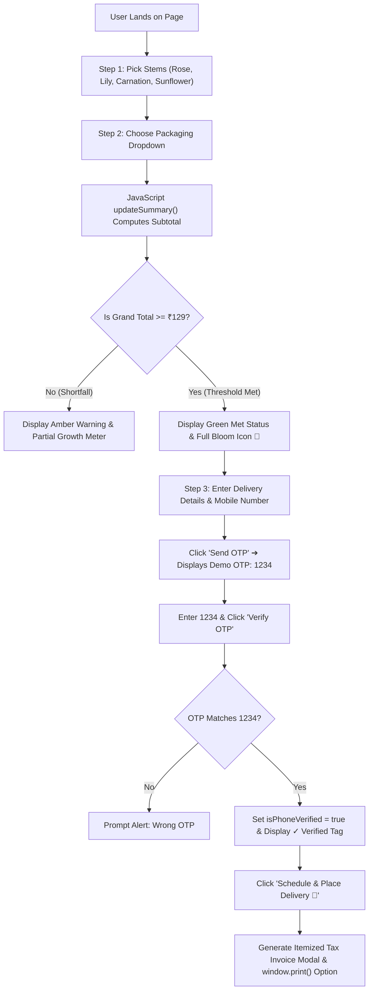
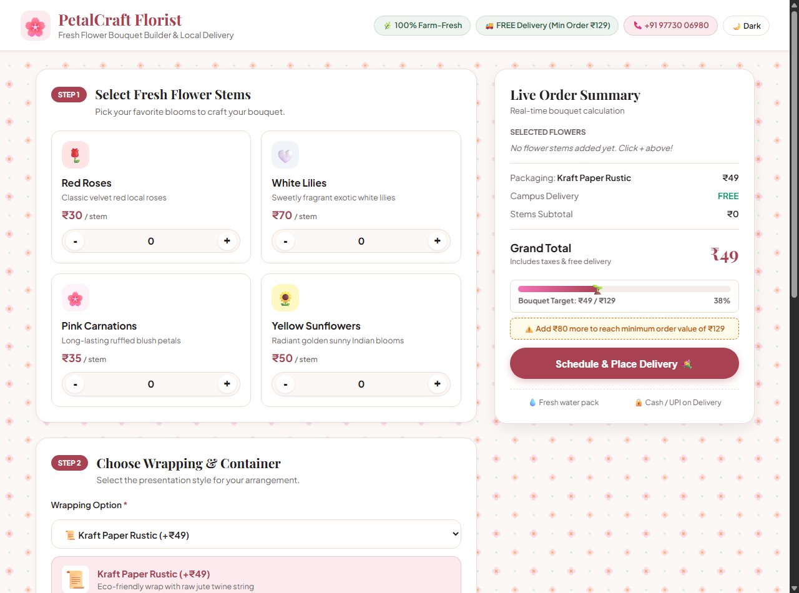
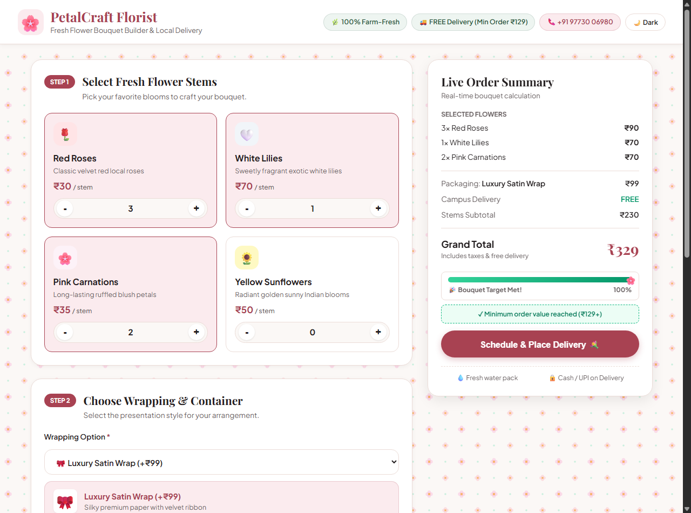
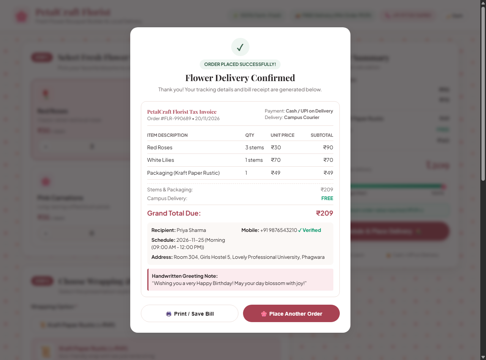
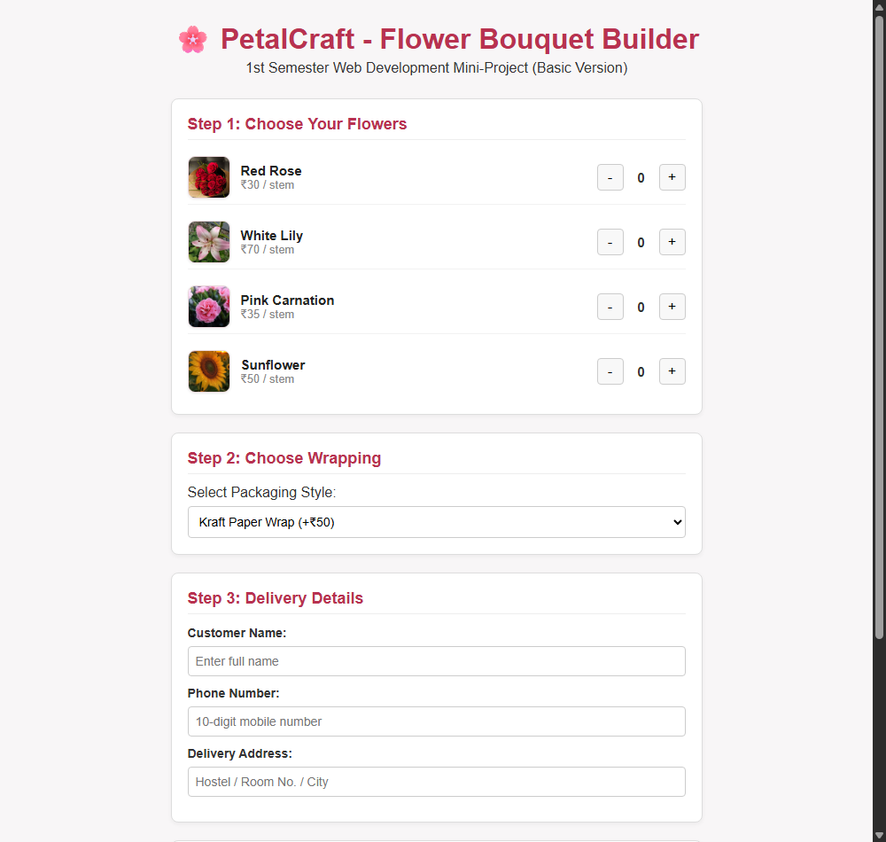

# 🌸 PetalCraft Florist - Local Fresh Flower Bouquet Builder & Delivery System
**Course Project Report for CSE 326 (Internet Programming / Web Development Laboratory)**  
*School of Computer Science & Engineering, Lovely Professional University (LPU), Phagwara, Punjab*

---

### 🎓 Academic Submission Details
| Parameter | Student & Submission Details |
| :--- | :--- |
| **Student Name** | **Shaswat Sinha** |
| **Registration Number** | **12629556** |
| **Academic Program** | **B.Tech. Computer Science & Engineering (Data Science with ML)** |
| **Semester** | **Semester 1** |
| **Course Code & Title** | **CSE 326: Internet Programming / Web Development Laboratory** |
| **Faculty & Evaluator** | **Abass Hassan Sir** (School of Computer Science & Engineering) |
| **University** | **Lovely Professional University (LPU), Punjab** |
| **Video Presentation Link** | **[Watch on YouTube (Click Here)](https://youtu.be/ju_i3vaFXE0)** (`https://youtu.be/ju_i3vaFXE0`) |
| **GitHub Repository** | [github.com/shaswat2406/flower-bouquet-builder](https://github.com/shaswat2406/flower-bouquet-builder) |
| **Live Project Link** | [shaswat2406.github.io/flower-bouquet-builder](https://shaswat2406.github.io/flower-bouquet-builder/) |

---

## 🎥 Project Video Presentation & Demonstration
* **YouTube Walkthrough URL:** **[https://youtu.be/ju_i3vaFXE0](https://youtu.be/ju_i3vaFXE0)**  
* **Demonstration Summary:** A complete live demonstration walkthrough recorded by Shaswat Sinha covering the 3-step bouquet builder, live calculation, demo mobile OTP verification (`1234`), printable invoice modal with `@media print`.

---

## 1. Executive Summary & Abstract
**PetalCraft Florist** is a modern, responsive frontend web application developed as a 1st-semester engineering mini-project. It simulates an independent, on-campus boutique florist located adjacent to Block 34 (School of Computer Engineering) at Lovely Professional University.

The platform provides an intuitive, step-by-step interactive workflow enabling customers to:
1. Custom-craft fresh flower bouquets stem-by-stem with live counter controls.
2. Select packaging containers (Kraft Paper, Satin Wrap, Glass Vase, Woven Basket).
3. Monitor order pricing in real-time through an interactive ₹129 Minimum Order Value (MOV) growth meter.
4. Validate recipient delivery details and verify mobile numbers via a 4-digit demo OTP (`1234`).
5. Generate an itemized, printable tax invoice receipt with a unique order tracking code.

The application is built strictly using standard web fundamentals—**Semantic HTML5, CSS3 (Custom Properties, Flexbox, Grid), and pure Vanilla JavaScript (ES6+)**—with zero external framework overhead, ensuring fast loading speeds, clean code readability, and complete syllabus alignment.

---

## 2. Project Objectives
* **Interactive Frontend Architecture**: Develop a dynamic single-page web interface without using heavy JavaScript frameworks (React, Angular, or Vue).
* **Real-Time Client-Side Computing**: Perform instant mathematical price calculations, input validation, and DOM manipulation via event listeners.
* **Responsive Visual Design**: Create a mobile-first, fluid layout using CSS Flexbox and 2-dimensional CSS Grid that seamlessly adapts across mobile phones, tablets, and desktop displays.
* **Campus-Centric Personalization**: Integrate localized campus pricing in Indian Rupees (₹), free campus delivery logic, customer support helpline (`+91 97730 06980`), and an interactive Google Map preview of Block 34 CSE.
* **Dual-Theme Support**: Deliver a luxury dark velvet theme alongside a pastel floral aesthetic using native CSS Custom Properties (`:root`).

---

## 3. Technology Stack & Tools Used
| Layer | Technology | Primary Role in Project |
| :--- | :--- | :--- |
| **Markup** | **Semantic HTML5** | Structural skeleton (`<header>`, `<main>`, `<section>`, `<article>`, `<aside>`, `<footer>`, `<form>`, `<iframe>`) |
| **Styling** | **Modern CSS3** | Custom Properties (`:root`), Flexbox, CSS Grid, media queries, print styles, and micro-interactions |
| **Logic** | **Vanilla JavaScript (ES6+)** | State management, arithmetic calculations, DOM updates, OTP validation, and modal control |
| **Typography** | **Google Fonts** | *Playfair Display* (Editorial Serif headings) and *Plus Jakarta Sans* (Clean geometric body text) |
| **Storage** | **Web Storage API (`localStorage`)** | Persisting user theme selection across browser sessions |
| **Version Control** | **Git & GitHub** | Source code management, continuous commits, and GitHub Pages web hosting |

---

## 4. System Architecture & Data Flow



---

## 5. Key Modules & User Interface Showcase

### 5.1 Main Interface & Layout Overview
The interface features a 2-column layout on desktop: the left column (`1.7fr`) holds the 3-step order builder, while the right column (`1fr`) features a sticky `position: sticky; top: 1.5rem;` Live Order Summary card.



* **Top Site Header**: Displays the brand emblem, title, tagline, farm-fresh badges, helpline click-to-call link.
* **Background Wallpaper**: A lightweight repeating SVG pattern of pastel flowers (`🌸`, `🌼`, `🌱`) renders directly in CSS without loading external image assets.

---

### 5.2 Step-by-Step Bouquet Customizer & Live Growth Meter
Customers choose their flower quantities using `+` and `-` buttons. The flower cards dynamically highlight with a soft rose tint (`.has-selected`) when added.



* **Stem Rates**: Red Roses (₹30), White Lilies (₹70), Pink Carnations (₹35), and Yellow Sunflowers (₹50).
* **Wrapping Dropdown**: Real-time icon and description preview updates whenever the user selects a container option.
* **Interactive Growth Meter**: Tracks progress toward the ₹129 minimum order value. The flower icon morphs dynamically: `🌱` (<40%) ➔ `🌿` (40–69%) ➔ `🌷` (70–99%) ➔ `🌸` (100%).

---

### 5.3 Mobile OTP Verification & Printable Invoice Modal
To mirror modern on-demand delivery apps (Swiggy, Blinkit, Zomato), checkout is protected by instant mobile OTP verification.



* **Authentication**: Users enter a 10-digit number; clicking "Send OTP" reveals the demo box (`1234`). Verifying unlocks the checkout button and marks the number as `✓ Verified`.
* **Printable Invoice**: Features an auto-generated random order tracking ID (`FLR-XXXXXX`), order timestamp, itemized billing table, delivery schedule, and handwritten greeting card preview.
* **Print Stylesheet (`@media print`)**: Formats the modal into a clean standalone A4 paper invoice when clicking "Print / Save Bill" (`window.print()`).

---

### 5.4 Safety Backup Version (`basic-version/`)
To guarantee confidence during Viva examinations, an ultra-simple backup version is included in a dedicated subfolder (`basic-version/`).



* **Ultra-Lean Footprint**: Contains only ~70 lines of JavaScript, simple Arial typography, and zero complex CSS rules, making it effortless to explain line-by-line in under 2 minutes.

---

## 6. Code Highlights & Implementation Details

### 6.1 Responsive CSS Grid Without Media Queries
```css
.flowers-grid {
  display: grid;
  grid-template-columns: repeat(auto-fit, minmax(220px, 1fr));
  gap: 1rem;
}
```
* **Explanation**: Automatically calculates the optimal number of columns based on available container width. Cards maintain a minimum width of `220px` and expand proportionally (`1fr`), eliminating the need for rigid device-specific breakpoints.

### 6.2 Elegant Quantity Stepper with Math Clamping
```javascript
function changeQty(flower, change) {
  quantities[flower] = Math.max(0, quantities[flower] + change);
  document.getElementById(`qty-${flower}`).textContent = quantities[flower];
  document.querySelector(`.flower-card[data-flower="${flower}"]`)
    ?.classList.toggle('has-selected', quantities[flower] > 0);
  updateSummary();
}
```
* **Explanation**: Uses `Math.max(0, ...)` to guarantee quantities never drop below zero. Updates the specific stem counter in the DOM and toggles card visual selection in a single, clean function.

## 7. Verification & Test Cases

| Test Case | Scenario Tested | Input Provided | Expected Result | Actual Result | Status |
| :--- | :--- | :--- | :--- | :--- | :--- |
| **TC-01** | Negative Quantity Prevention | Click `-` button when count is 0 | Counter remains at 0 | Value stays clamped at 0 | **PASSED** |
| **TC-02** | Minimum Order Value (MOV) | Total stems + wrap < ₹129 | Click "Place Delivery" | Alert displays: shortfall amount needed | **PASSED** |
| **TC-03** | Phone Number Length Check | Less than 10 digits | Click "Send OTP" | Alert: "Please enter a valid 10-digit mobile number" | **PASSED** |
| **TC-04** | Demo OTP Verification | Enter code "1234" | Click "Verify OTP" | Box hides, displays green `✓ Verified` tag | **PASSED** |
| **TC-05** | Incorrect OTP Handling | Enter code "9999" | Click "Verify OTP" | Alert: "Wrong OTP! Please enter test OTP: 1234" | **PASSED** |
| **TC-06** | Past Date Calendar Blocking | Open date picker dropdown | Current date | Past calendar days disabled (`min` attribute) | **PASSED** |
| **TC-07** | Print Stylesheet Trigger | Click "Print / Save Bill" | Native print command | Hides background UI; displays clean A4 invoice | **PASSED** |

---

## 8. Conclusion & Future Scope
The **PetalCraft Florist** project successfully demonstrates how modern, production-grade user experiences can be constructed using vanilla web standards without external dependencies. 

### Future Enhancements:
1. **Payment Gateway Integration**: Adding live Razorpay / UPI intent QR code checkout.
2. **Backend Database**: Connecting a Node.js / Express backend with MongoDB to store customer orders permanently.
3. **SMS Gateway**: Integrating Twilio or Fast2SMS for live SMS OTP delivery to mobile phones.
4. **Driver GPS Tracking**: Providing live on-campus courier tracking across Lovely Professional University hostel blocks.
